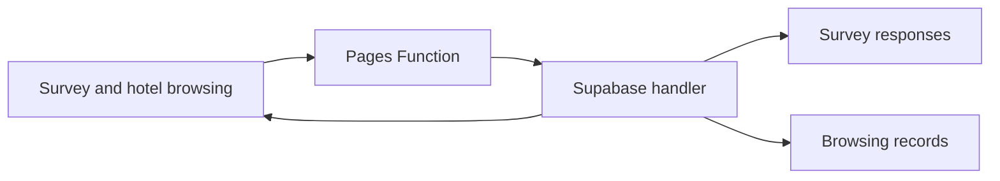

# Project guide

This experiment compares hotel choices under full-review and AI-summary
conditions, with 10-second and 2-second minimum viewing times. The study
materials, questionnaires, client code, server handler, and schema are in this
repository.

## Reading the code

| Area | Entry point | Role |
| --- | --- | --- |
| Survey | [`index.html`](../index.html) | Full-review questionnaire and stage navigation |
| Alternate conditions | [`survey-summaries.html`](../survey-summaries.html), [`survey-min2sec.html`](../survey-min2sec.html), [`survey-summaries-min2sec.html`](../survey-summaries-min2sec.html) | AI-summary and shorter-viewing variants |
| Hotel browsing | [`assets/js/hotel-listings.js`](../assets/js/hotel-listings.js) | Hotel content, popups, and browsing interactions |
| Confirmed saves | [`assets/js/survey-storage.js`](../assets/js/survey-storage.js) | Server acknowledgements and resume behavior |
| Browsing events | [`assets/js/survey-tracking.js`](../assets/js/survey-tracking.js) | Active viewing and event delivery |
| API entry | [`functions/api/survey.js`](../functions/api/survey.js) | Pages Function entry point |
| Server behavior | [`backend/supabase/handler.mjs`](../backend/supabase/handler.mjs) | Validation, response storage, and visit aggregation |
| Schema and configuration | [`backend/supabase/SETUP.md`](../backend/supabase/SETUP.md) | Database initialization and server bindings |
| Regression checks | [`tests/`](../tests/) | Mocked client and server tests |

## Data flow

The server confirms saves before the questionnaire advances. Browsing delivery
uses visit identifiers and revisions to handle repeated or delayed requests.
The server also checks the condition-specific active-viewing minimum.

## Working locally

Run `npm ci --ignore-scripts` followed by `npm test` from the repository root.
These checks use mocked requests and database responses. They can exercise
resume, timing, retry, and aggregation behavior without study credentials.

For a static layout preview, `python3 -m http.server 8000` serves the files at
`http://localhost:8000`. This server does not implement `/api/survey`, so it
cannot complete the saved questionnaire workflow.

Use a separate deployment and database for integration testing. The live study
URL in the README writes participant responses; it is not an offline demo.
Mocked test results do not establish the current state of production bindings
or database migrations.
